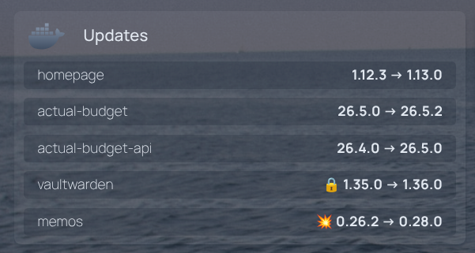

# rigr

`rigr` is a small homelab service that inspects **running Docker containers**, reads their labels, fetches **RSS/Atom release feeds**, and reports **available updates** via HTTP API in **JSON** and **RSS** formats.



## Features

- Docker label-based app discovery
- JSON + RSS endpoints for update reporting
- Integration with [gethomepage/homepage](https://github.com/gethomepage/homepage/) via a Homepage-friendly endpoint (`/api/v1/homepage/updates`)

## Quick start (Docker Compose)

Create `docker-compose.yml`:

```yaml
services:
  rigr:
    image: ghcr.io/russ-p/rigr:latest # replace `latest` with a pinned version for production
    container_name: rigr
    restart: unless-stopped
    ports:
      - "8080:8080"
    environment:
      - POLL_INTERVAL=15m # how often to poll release feeds
      - HTTP_BIND=0.0.0.0:8080 # HTTP listen address
      - HTTP_TIMEOUT=10s # outbound HTTP timeout (feeds)
      - LABEL_PREFIX=rigr. # Docker label prefix used for config discovery
      - MAX_FEED_ENTRIES=50 # limit fetched feed entries per app
      - LOG_LEVEL=info # debug|info|warn|error
      - UPDATE_SEVERITY_ENABLED=true # enable severity classification from release notes
    volumes:
      - /var/run/docker.sock:/var/run/docker.sock:ro
```

Run:

```bash
docker compose up -d
```

Then check:

- `GET http://localhost:8080/health`
- `GET http://localhost:8080/api/v1/apps`

## How it discovers apps

Only containers with the required label are tracked.

- Required: `rigr.release_feed` — absolute URL to an RSS or Atom feed (e.g. GitHub `releases.atom`).
- Optional: `rigr.name` — override the displayed app name (otherwise the container name is used).

The label prefix is configurable via `LABEL_PREFIX` (default: `rigr.`).

## Version matching behavior

`rigr` uses the **image tag** as the current version source, but compares by an extracted **match version** (defaults to semver core `X.Y.Z`).

Examples:
- `ghcr.io/org/app:v1.2.3` → match version `1.2.3`
- `ghcr.io/actualbudget/actual:26.5.0-alpine` → match version `26.5.0` (variant suffix is ignored by default)

- If a matching entry is found, all entries **newer** (above it in the feed) are returned as `updates_available`.
- If no matching entry is found, the app is reported with `match_status: "no_match"`, and `latest_known_release` is returned, but `updates_available` stays empty (to avoid false positives).

### Optional labels for version extraction

You can override how versions are extracted using regex labels (useful when tags/titles are not plain semver):

- `rigr.image_version_regex`: regex applied to the **image tag**.
- `rigr.feed_version_regex`: regex applied to **feed item title/link**.

Rules:
- If the regex matches and has a capture group 1, that group is used as the version.
- Otherwise the full match is used.
- For feed matching, title is tried first; if it doesn't match, link is tried.

Defaults:
- `rigr.image_version_regex`: `(?i)\\bv?(\\d+\\.\\d+\\.\\d+)\\b`
- `rigr.feed_version_regex`: `(?i)\\bv?(\\d+\\.\\d+\\.\\d+)\\b`

### Skipping pre-release feed entries

Feed items whose **title or link** match `rigr.skip_version_regex` are ignored when determining `latest_known_release`, `latest_match_version`, and `updates_available`. This keeps dev/rc pre-releases from being reported as available updates.

- `rigr.skip_version_regex`: regex applied to **feed item title/link**.
- Set to `-`, `off`, or `none` to disable filtering.

Default:
- `rigr.skip_version_regex`: `(?i)(?:[-.]?(?:dev|rc\\d*)|b\\d+)$` — skips suffixes like `-dev`, `-rc`, `-rc1`, `2026.7.0b2`.

## API

- `GET /health`
- `GET /api/v1/apps`
- `GET /api/v1/apps/{container_id}`
- `GET /api/v1/updates` (machine-oriented JSON for scripts/agents)
- `GET /api/v1/homepage/updates` (Homepage-friendly JSON)
- `GET /feed.xml` (RSS)
- `GET /api/v1/updates.rss` (RSS alias)

### Machine-oriented updates example

`GET /api/v1/updates` is intended for programmatic consumers (CLI scripts,
agents that upgrade image tags). Unlike the Homepage endpoint it exposes the
**exact release titles** (including `v`-prefix and variant suffixes), the exact
running **image tag**, the **full list** of pending updates, and a
**prerelease** flag per release.

- Returns a **root JSON array**.
- Includes only apps with pending updates by default; apps with an empty
  `updates_available` are added with `?include_up_to_date=true`.
- `?container=<name>` filters to a single container by exact name.
- Items are sorted by newest pending release `published_at` first (missing
  timestamps last), then by `container_name`.
- `recommended` is the newest **non**-pre-release pending update — the release an
  agent should upgrade to. It is `null` when only pre-releases are pending;
  consumers should ask a human instead of upgrading automatically.
- `prerelease` marks entries whose release title matches `PRERELEASE_REGEX`.
  This is classification only: the `skip_version_regex` feed filter is not
  affected.
- App-level `severity` is the max severity across `updates_available`.

Example response (trimmed to two apps):

```json
[
  {
    "container_name": "gitea",
    "container_id": "abc123",
    "image": "docker.gitea.com/gitea:28.3.0",
    "current_tag": "28.3.0",
    "current_match_version": "28.3.0",
    "release_feed": "https://github.com/go-gitea/gitea/releases.atom",
    "match_status": "matched",
    "severity": "security_fixes",
    "last_checked_at": "2026-11-19T18:30:00Z",
    "recommended": {
      "title": "v28.4.0",
      "match_version": "28.4.0",
      "release_notes_url": "https://github.com/go-gitea/gitea/releases/tag/v28.4.0",
      "published_at": "2026-11-15T19:39:47Z",
      "severity": "security_fixes",
      "prerelease": false
    },
    "updates_available": [
      {
        "title": "v28.4.0",
        "match_version": "28.4.0",
        "release_notes_url": "https://github.com/go-gitea/gitea/releases/tag/v28.4.0",
        "published_at": "2026-11-15T19:39:47Z",
        "severity": "security_fixes",
        "prerelease": false
      }
    ]
  },
  {
    "container_name": "filebrowser-quantum",
    "container_id": "def456",
    "image": "ghcr.io/gtsteffaniak/filebrowser:2.0.2-stable-slim",
    "current_tag": "2.0.2-stable-slim",
    "current_match_version": "2.0.2",
    "release_feed": "https://github.com/gtsteffaniak/filebrowser/releases.atom",
    "match_status": "matched",
    "severity": "security_fixes",
    "last_checked_at": "2026-11-19T18:30:00Z",
    "recommended": null,
    "updates_available": [
      {
        "title": "v2.1.5-beta",
        "match_version": "2.1.5",
        "release_notes_url": "https://github.com/gtsteffaniak/filebrowser/releases/tag/v2.1.5-beta",
        "published_at": "2026-11-14T00:44:01Z",
        "severity": "security_fixes",
        "prerelease": true
      },
      {
        "title": "v2.1.4-beta",
        "match_version": "2.1.4",
        "release_notes_url": "https://github.com/gtsteffaniak/filebrowser/releases/tag/v2.1.4-beta",
        "published_at": "2026-10-31T13:37:41Z",
        "severity": "default",
        "prerelease": true
      }
    ]
  }
]
```

Query parameters:

- `container` — exact container name; only that app is returned (empty array
  when there is no match).
- `include_up_to_date` — `true`/`1`/`yes`/`on` add apps without pending updates
  (with an empty `updates_available` array).

### Homepage (gethomepage/homepage) example

This endpoint is designed for the `customapi` **dynamic-list** widget.

- It returns a **root JSON array**.
- It includes **only apps with confirmed updates** (`updates_available` is non-empty).
- Items are sorted by newest `published_at` first, then by `container_name`.

Example widget config snippet:

```yaml
- Updates:
    icon: si-docker
    widget:
      type: customapi
      url: http://rigr:8080/api/v1/homepage/updates
      method: GET
      display: dynamic-list
      mappings:
        name: container_name
        label: version_line
        target: "{changelog_url}"
```

## Configuration (env)

- `LABEL_PREFIX` (default `rigr.`)
- `POLL_INTERVAL` (default `15m`)
- `HTTP_BIND` (default `0.0.0.0:8080`)
- `HTTP_TIMEOUT` (default `10s`)
- `USER_AGENT` (default `rigr/0.1 (+https://github.com/)`)
- `MAX_FEED_ENTRIES` (default `50`)
- `UPDATE_SEVERITY_ENABLED` (default `false`) — when enabled, classifies update severity from feed item text and:
  - adds `severity` to `updates_available` items in JSON (`default|breaking_changes|security_fixes`)
  - prefixes RSS item titles and homepage `version_line` with emoji for non-default severity (`💥` breaking, `🔒` security)
- `PRERELEASE_REGEX` (default `(?i)(?:alpha|beta|rc\d*|next|dev|snap(?:shot)?|pre(?:view|release)?)|b\d+(?:$|[-._])`) — marks release titles as pre-releases for `/api/v1/updates` (`prerelease` flag and `recommended` selection). Classification only: it does not filter feeds (`skip_version_regex` is unaffected).
- `LOG_LEVEL` (default `info`) — `debug|info|warn|error`

## Configuration (CLI)

- `--log-level` — `debug|info|warn|error` (overrides `LOG_LEVEL`)

## Security note

To read container metadata, `rigr` typically needs access to the Docker socket. In a homelab this is often acceptable, but the socket effectively grants root-equivalent control over the host.

